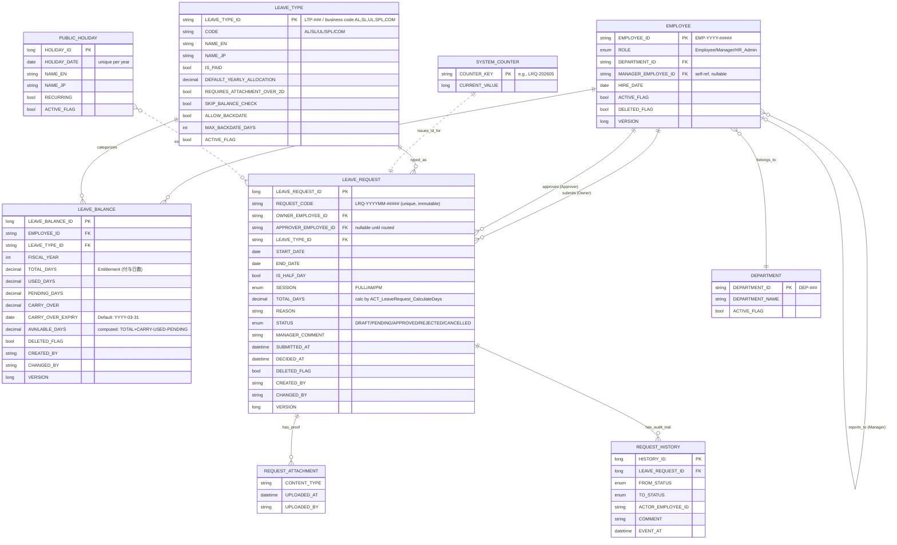

# 01. Physical ER Diagram — Mendix Leave Management System

**Source RD**: `Requirement Defination Document.md §3.2`, `Domain Definition.md`, `Code Definition.md`, `Domain Glossary.md`
**Target stack**: Mendix Studio Pro (Internal Database). Entity names are PascalCase singular per `Code Definition.md §5`.
**Audit columns**: Every business entity carries `createdDate`, `changedDate`, `createdBy`, `changedBy`, `version` (optimistic locking). Audit trail mandated by `Requirement Defination Document.md §4.3`.
**Soft delete**: Applied to transactional / master entities that require historical retention (`LeaveRequest`, `LeaveBalance`, `Employee`).

---

## 1. Mermaid ER Diagram

---

## 2. Table Catalog

| Physical Table         | Type        | Purpose                                                    | Source |
|------------------------|-------------|------------------------------------------------------------|--------|
| `EMPLOYEE`             | Master      | User profile extending `Administration.Account`            | RDD §3.2 |
| `DEPARTMENT`           | Master      | Organisational unit. Required by `DEP-###` ID format        | Code Def §1 |
| `LEAVE_TYPE`           | Master      | Leave categories (AL/SL/UL/SPL/COM)                         | Domain Def §2.A |
| `LEAVE_BALANCE`        | Transaction | Per-employee per-type entitlement / usage                   | RDD §3.2 |
| `LEAVE_REQUEST`        | Transaction | Workflow record (Draft → Approved/Rejected)                 | RDD §3.2 |
| `REQUEST_ATTACHMENT`   | Transaction | Medical Cert proof when SL > 2d (BR-08)                     | Business Rules BR-08 |
| `REQUEST_HISTORY`      | Audit       | Mandatory state-transition log                              | RDD §4.3 |
| `PUBLIC_HOLIDAY`       | Master      | Used by day-count exclusion (BR-04)                         | Business Rules BR-04 |
| `SYSTEM_COUNTER`       | System      | Issues sequential numbers for `LRQ-YYYYMM-#####`            | Code Def §4 |

---

## 3. Index Recommendations

| Table            | Index                                                | Rationale                                            |
|------------------|------------------------------------------------------|------------------------------------------------------|
| `EMPLOYEE`       | UQ(`ACCOUNT_GUID`), IX(`DEPARTMENT_ID`), IX(`MANAGER_EMPLOYEE_ID`) | Login lookup, dept filter, team retrieval. |
| `LEAVE_BALANCE`  | UQ(`EMPLOYEE_ID`,`LEAVE_TYPE_ID`,`FISCAL_YEAR`), IX(`EMPLOYEE_ID`) | One row per emp/type/year; dashboard query.  |
| `LEAVE_REQUEST`  | UQ(`REQUEST_CODE`), IX(`OWNER_EMPLOYEE_ID`,`STATUS`), IX(`APPROVER_EMPLOYEE_ID`,`STATUS`), IX(`START_DATE`,`END_DATE`) | History list, manager queue, overlap check (BR-07). |
| `REQUEST_HISTORY`| IX(`LEAVE_REQUEST_ID`)                              | Trace lookup.                                        |
| `PUBLIC_HOLIDAY` | UQ(`HOLIDAY_DATE`)                                  | BR-04 day-count exclusion.                           |
| `SYSTEM_COUNTER` | PK(`COUNTER_KEY`)                                   | Atomic increment (lock row in `SUB_GenerateCode`).   |

---

## 4. Notes for SA Review

- **`EMPLOYEE` specializes `Administration.Account`**: `AccountGuid`, `FullName`, `Email` are inherited from `Administration.Account`/`System.User` and must NOT be re-declared. XPath for current-user scoping on this entity uses `[id = '[%CurrentUser%]']` directly (no association join needed).
- **`REQUEST_ATTACHMENT` specializes `System.FileDocument`**: `FileName` (→ `Name`), `FileBlob` (→ `Contents`), `SizeBytes` (→ `Size`), `AttachmentId` (→ built-in `id`) are all inherited and must NOT be re-declared. `LeaveRequestId` FK is replaced by the `Attachment_LeaveRequest` association.
- **`createdDate` / `changedDate` / `owner` / `changedBy` on all entities**: managed by Mendix system flags (`hasCreatedDate=true` / `hasChangedDate=true` / `hasOwner=true` / `hasChangedBy=true`) — do not declare `CreatedBy`, `ChangedBy`, or their synonyms as user attributes. All four flags are set on every non-specialization business entity (`LeaveBalance`, `LeaveRequest`). Specialization entities (`Employee`) inherit these from the root ancestor and must not redeclare them.
- `LEAVE_BALANCE.AVAILABLE_DAYS` may be **stored derived** (kept in sync via `ACT_LeaveBalance_Recalculate`) **OR** **computed-at-read** via Calculated attribute. Decision deferred to SA — see `99_gap_report.md`.
- Soft delete (`DELETED_FLAG`) vs. hard delete on `LEAVE_REQUEST` cancellation: per `Code Definition.md §2`, `CANCELLED` is "Logical delete (record remains for audit)" → use status, not `DELETED_FLAG`.
- M:N between `LEAVE_REQUEST` and `PUBLIC_HOLIDAY` is **not materialised** — exclusion is computed in `SUB_CalculateDays` (BR-04).
